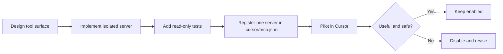

# Add Internal MCP

Use this plan when extending the project-local MCP surface.

## Objective

Expose repo-native capabilities to Cursor without weakening the core runtime.

## Rules

- keep the server outside `agent_infra`
- read-only only in wave 1
- prefer one new server at a time
- require a local fit note and tests before registration

## Enablement order

1. `concentric-health`
2. `concentric-trace`
3. `concentric-benchmark`
4. `concentric-research`

