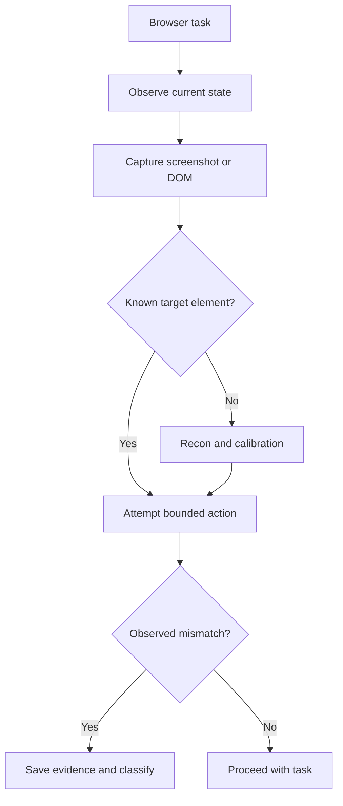

# Browser Task Triage

Use this plan for browser or visual-agent work in Cursor.

## Objective

Treat the browser as a measurement surface, not just a screenshot source.

## Procedure

1. Capture the current UI state before acting.
2. Confirm the real target surface, not just the visible page chrome.
3. Use the integrated browser for screenshots and DOM evidence.
4. Record the exact page state when a bug appears.
5. Distinguish site behavior from Cursor browser-tool behavior.

