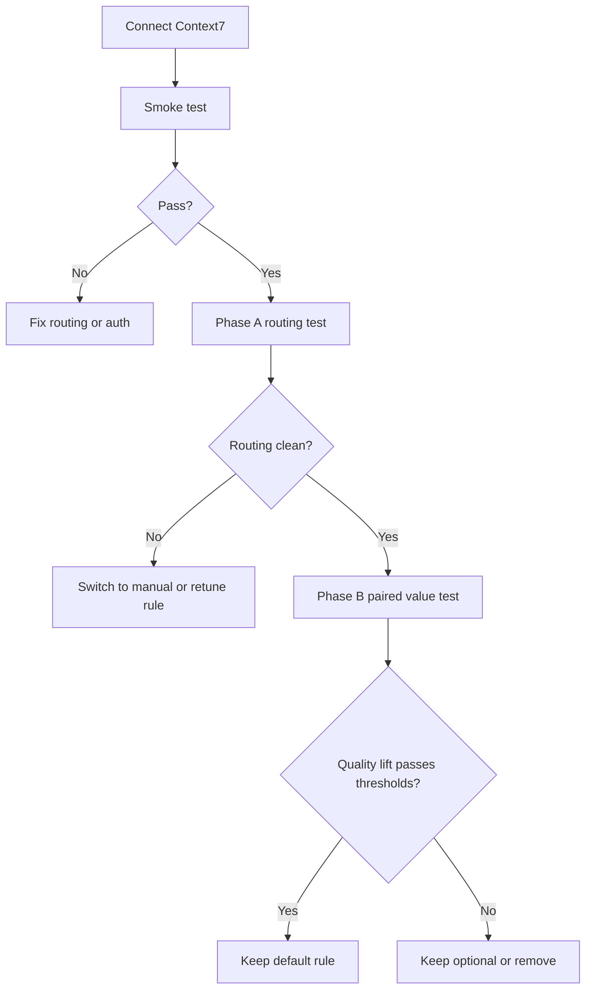

# Context7 Pilot

Use this plan when validating whether Context7 should remain a default MCP for
current package and SDK documentation.

## Objective

Determine whether Context7 improves answer quality enough to justify keeping the
project rule active by default.

## Inputs

- `operator/cre/CONTEXT7_PILOT_PHD.md`
- `operator/cre/artifacts/context7_pilot_rubric.json`
- `operator/cre/artifacts/context7_pilot_results_template.json`

## Procedure

1. Confirm the `context7` MCP is connected.
2. Run the smoke test from the pilot memo.
3. Run Phase A selective invocation on the fixed 10-question bank.
4. Run Phase B paired comparison on the 8 positive controls.
5. Apply the explicit pass, mixed, or fail thresholds.
6. Record the verdict in the results artifact and memo.

