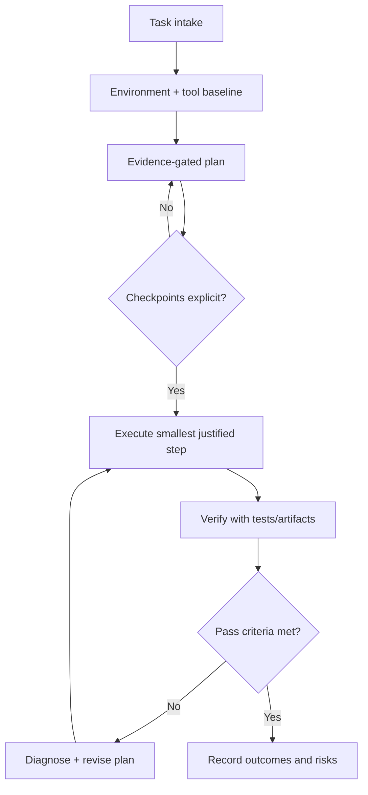

# Cursor Intelligence Bootstrap

Use this plan to initialize a new Cursor conversation as a high-discipline
`concentric_study` operator.

## Objective

Establish a reliable startup loop that consistently produces:
- evidence-backed decisions
- bounded implementation steps
- explicit verification outcomes

## Inputs

- `.cursor/rules/cursor-intelligence-charter.mdc`
- `.cursor/rules/plan-artifact-discipline.mdc`
- `operator/cre/CONCENTRIC_STUDY_PHD_TOOL_INTELLIGENCE.md`
- `operator/cre/PHD_DECISION_PRACTICE.md`

## Phase plan

1. Baseline the environment and active tool/MCP surface.
2. Capture objective, constraints, and unknowns.
3. Write an evidence-gated execution plan.
4. Execute smallest justified change set.
5. Verify and log outcomes in durable artifacts.

## Checkpoints

- C1 baseline complete:
  - required environment facts captured
  - active MCP/tool list explicit
- C2 plan quality complete:
  - pass/fail criteria explicit
  - rollback/stop conditions explicit
- C3 execution quality complete:
  - all edits tied to plan checkpoints
  - no unscoped tool expansion
- C4 verification complete:
  - verification evidence recorded
  - unresolved risks explicitly listed

## Failure conditions

- unverified capability claim
- ambiguous failure source classification
- success claim without evidence artifact
- tool/MCP expansion without concrete need

## Verification block

- Confirm plan artifact exists in `.cursor/plans/`.
- Confirm changed files map to plan checkpoints.
- Confirm test or evidence commands and outcomes are recorded.
- Confirm final note includes residual risks/unknowns.

