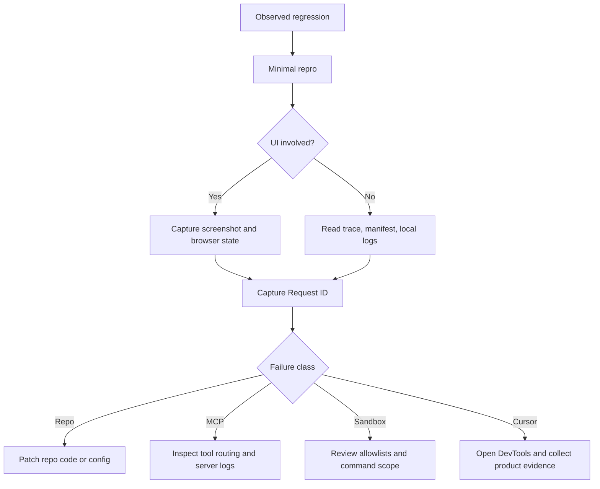

# Debug Runtime Regression

Use this plan when a previously working repo behavior regresses and you need to
separate repo failure from Cursor or MCP failure.

## Goal

Reach a bounded diagnosis before changing runtime code.

## Protocol

1. Start a fresh chat and use `/plan`.
2. Reproduce the failure with the smallest real case.
3. Capture:
   - Request ID
   - relevant trace or manifest path
   - screenshot or browser evidence if UI is involved
   - DevTools console only if the failure looks Cursor-level
4. Classify the failure before editing:
   - repo/runtime bug
   - MCP routing or tool bug
   - sandbox/network policy issue
   - Cursor product issue
5. Only then choose the narrowest corrective change.

