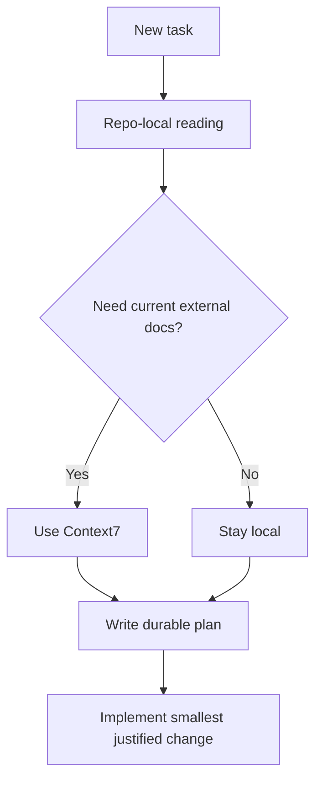

# Research Before Runtime

Use this plan for any non-trivial task where the implementation path is still
unclear.

## Goal

Separate repo-local facts, external documentation facts, and design choices
before writing code.

## Procedure

1. Use `/ask` or `/plan` first.
2. Read the relevant repo files.
3. If the answer depends on current third-party docs, use Context7.
4. Save the plan into `.cursor/plans/` if the task will take multiple steps.
5. Only move to edits after the evidence path is explicit.

