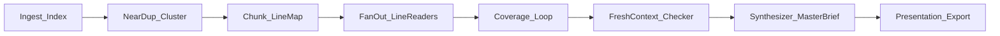

# Workers’ Comp iCloud → Master Brief (Agents / Loops / Graphs)

## Objective
Ingest a local/iCloud workers’ compensation document corpus, de-dupe near-copies without discarding meaningful diffs, flag possible company-policy and California WC rule gaps for human lawyer review, and produce one master presentation/brief.

## Constraints
- Output is **triage / prep**, not legal advice or a finding of violation.
- Treat files as sensitive (PII/medical); keep local; do not upload wholesale to random tools.
- Run on the Mac where iCloud Drive is mounted (`~/Library/Mobile Documents/...` or synced folder), not on this Linux cloud VM unless files are explicitly synced here.
- Stop if credentials, sealed records, or attorney–client privileged materials would be exposed without user approval.
- “Word by word / line by line” means **full coverage with citations**, not one model stuffing the whole corpus into one context window.

## Pattern mapping



| Layer | Role here |
|-------|-----------|
| Agent | Goal-driven review worker with tools (read PDF/DOCX, extract text, cite page/line) |
| Loop | Coverage loop until every line-range is read + scored; finding loop until criteria clear |
| Graph | Diamond: inventory → chunk → parallel line readers → checker → master brief |

---

## Observed corpus (Finder / iCloud Drive)
Evidence from user’s Finder:
- Many ZIPs with cloud-download icons (not local yet).
- iCloud storage full warning — downloads/unzips may fail until space is freed.
- Near-identical names/sizes: `Legal Case Files.zip` … `Legal Case Files 10.zip` (~72 MB each) plus `Master Legal File.zip` (~43 MB).
- Unrelated ZIPs in same view (`AI BUILD.zip`, `M1 Mac.zip`, `Thorv2.zip`, etc.) — **exclude** from WC legal graph unless user marks them in-scope.

## NEXT PLAN — Phase 1.5 then Phase 2
**Do not start line-by-line until ZIPs are local, unzipped, and inventoried.**

### Phase 1.5 — ZIP / iCloud gate (NOW)
1. Free iCloud/local disk space (storage is full — blocker).
2. Download only the legal set first (not every ZIP on Drive).
3. Hash each ZIP; treat same-size `Legal Case Files N` as **probable near-dup archives**.
4. Unzip each into its own folder: `work/legal_case_files_N/`.
5. Build `inventory.json` of **inner files** (PDFs/DOCX/etc.), not just the zip names.
6. Compare archive member lists + content hashes → exact dup vs slight-diff clusters.
7. Pick **one pilot archive** (prefer `Master Legal File.zip` OR the smallest distinct cluster) before touching all 10.

Pass/fail for 1.5:
- [ ] Legal ZIPs downloaded (cloud icon gone)
- [ ] Unzipped without errors
- [ ] Outer ZIP hashes + inner file inventory written
- [ ] Near-dup cluster map for the 10× Legal Case Files set
- [ ] Unrelated ZIPs excluded from queue

Stop if: iCloud full blocks download; unzip password/corrupt; path not on the Mac running the agent.

## NEXT PLAN — Line-by-line full coverage (Phase 2)

### Why this is next
Phase 1 defined the diamond. Phase 2 is the missing mechanism: agents cannot “read everything” in one chat. They must **partition → parallel read → prove coverage → then analyze**. Phase 2 starts only after Phase 1.5 pass.

### Pass / fail checkpoints (Phase 2)
1. **Text extract exists** for every inventory file (or `unreadable` with reason).
2. **Line map** exists: every file split into numbered lines or page+line anchors.
3. **Chunk queue** built: chunks of ~80–150 lines (or 1–2 pages), each with `{file_id, start_line, end_line, text}`.
4. **Coverage ledger** hits 100%: every line-range has `status=read` and a worker output path.
5. **No silent skips**: blank pages, stamps, tables, headers/footers logged as `seen_nonprose` not ignored.
6. Spot audit: randomly open 10 chunks; human confirms agent cited the right lines.

### Stop / rollback
- Hard stop if coverage < 100% after max chunk retries (3 per chunk).
- Hard stop per file if OCR fails twice → `needs_human_scan`.
- Rollback = keep inventory + line maps; discard analysis findings from unread ranges.

### Graph nodes (paste-ready shape)

```yaml
workflow: wc-line-coverage-review

nodes:
  inventory:
    task: "Walk folder. Emit inventory.json (path, hash, mtime, bytes, type)."
    output: inventory.json

  extract:
    task: "For each file, extract plain text with page breaks. OCR images/scans."
    depends_on: [inventory]
    output: extracts/

  linemap:
    task: "Number every line. Emit line_map/{file_id}.jsonl with line_no + text."
    depends_on: [extract]
    output: line_maps/

  chunk:
    task: "Slice into chunks of 80-150 lines with overlap of 5 lines. Emit chunk_queue.json."
    depends_on: [linemap]
    output: chunk_queue.json

  # FAN-OUT: one worker per chunk (or batch of N chunks). No depends_on between siblings.
  read_chunk:
    task: |
      LINE READER — read ONLY the assigned line range, word by word.
      1. Restate start_line–end_line and file_id.
      2. Produce a line ledger: for each line, tag = fact | date | amount | name |
         obligation | denial | medical | procedural | boilerplate | blank | unclear.
      3. Extract structured hits with EXACT quotes and line numbers.
      4. Flag possible CA WC / company-policy tension ONLY if grounded in these lines.
      5. List contradictions inside this chunk only.
      OUT shape: chunk_findings.json
    # spawned in parallel from chunk_queue
    output: findings/chunks/

  coverage_loop:
    task: |
      LOOP until coverage_ledger shows 100% lines accounted for OR max 3 retries/chunk.
      CRITERIA (all must pass):
      - every chunk has findings file
      - every finding has cite {file_id, lines}
      - no chunk marked done with empty ledger unless all lines are blank
      If a chunk fails shape check → re-queue that chunk only.
    depends_on: [read_chunk]
    output: coverage_ledger.json

  near_dup_diff:
    task: "For near-duplicate clusters, line-align and emit delta sheets (kept vs dropped lines)."
    depends_on: [coverage_loop]
    output: diffs/

  checker:
    task: |
      Fresh context. Input = findings only, not worker chat.
      Try to DROP each issue: bad cite? quote not on those lines? not CA-relevant?
      not a policy gap? speculation?
      Keep only survivors labeled possible_issue | needs_lawyer | info_only.
    depends_on: [near_dup_diff]
    output: checker.md

  synthesize:
    task: "Build master presentation from survivors + coverage stats + near-dup deltas."
    depends_on: [checker]
    output: master_brief.md
```

### Line-reader agent prompt (core)

```text
You are a line-coverage reader for California workers’ compensation document triage.
You read ONLY the assigned line range. You do not summarize the whole case.

Rules:
- Process every line. Tag each line. No skipping.
- Every extracted fact must include exact quote + line number(s).
- If text is garbled/OCR junk, tag unclear and quote it raw.
- Do not allege violations. Use possible_issue / needs_lawyer / info_only.
- Do not use knowledge from outside this chunk except the fixed checklist in the system prompt.
- End with: lines_read_count, lines_total_in_chunk, coverage_ok true/false.
```

### Loop that enforces “actually read everything”

```text
Work in a loop on coverage_ledger.json until DONE or max 3 full passes.

GOAL: 100% of line ranges have status=read with valid chunk_findings.

CRITERIA:
- coverage_pct == 100
- every findings file validates against OUT shape
- random 5% of chunks re-opened by a second reader agree on quote+line cites (or flag mismatch)

EACH PASS:
1. List unread / invalid chunks
2. Re-run only those chunks
3. Recompute coverage_pct
4. If 100 and shape-valid → DONE else NEXT PASS
```

### Cost control (required)
- Prefer **code** for inventory, hashing, chunking, coverage math (no tokens).
- Use the model only for line tagging + issue extraction + checker + synthesis.
- Track keep-rate of checker; if <50%, shrink chunk size and tighten “no speculation.”

### Verification block
- Commands/artifacts to exist before analysis counts as done:
  - `inventory.json`
  - `line_maps/`
  - `chunk_queue.json`
  - `coverage_ledger.json` with `coverage_pct: 100`
  - `findings/chunks/*`
  - `checker.md`
  - `master_brief.md`
- Human: spot-check 10 random line cites against source files.

### Order that works (article rule)
1. Run manually on **one claim folder / ~20 files** first.
2. Lock prompts + chunk size + OUT shapes into a reusable template.
3. Only then fan out to the full iCloud tree.
4. Do **not** schedule Level-4 autonomy until keep-rate and cite accuracy are proven.

## Prior checkpoints (Phase 1 still apply)
1. Inventory complete.
2. Near-dup clusters labeled; diffs listed.
3. Every claim cites file + page/line; uncited claims fail checker.
4. Findings labeled possible_issue / needs_lawyer / info_only.
5. Master deck: exec summary, timeline, gap matrix, source map.

## Stop / rollback (global)
- Stop automation if a file won’t parse after 2 strategies; log and continue.
- Stop if user marks a folder privileged; exclude and note exclusion.
- Rollback = discard AI-generated brief; keep only inventory + line-map artifacts.
