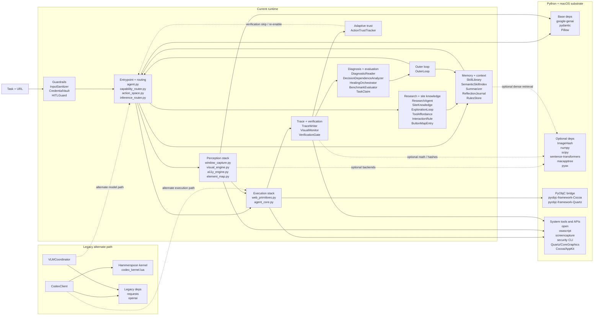

# Tool Connections Diagram

This diagram is the compact architecture view of how the current tools connect.
It is derived from the definitive inventory in `operator/cre/MASTER_TOOL_LIST_PHD.md`
and the stage grouping in `operator/cre/artifacts/tool_inventory_by_stage.json`.

## Reading Notes
- Left to right is the normal execution flow: guardrails, plan, perceive, act, verify, diagnose, adapt.
- The lower `Platform` layer is shared substrate, not an independent workflow stage.
- The `Legacy` block is intentionally separated because it is still present in-repo but not the primary runtime.
