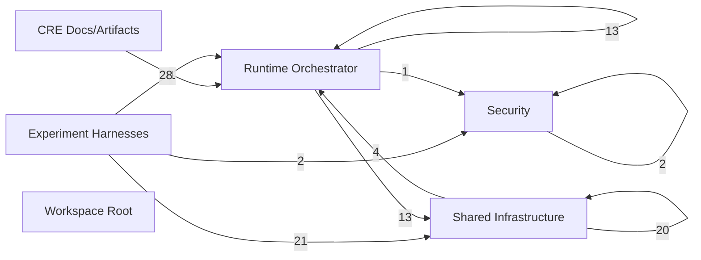
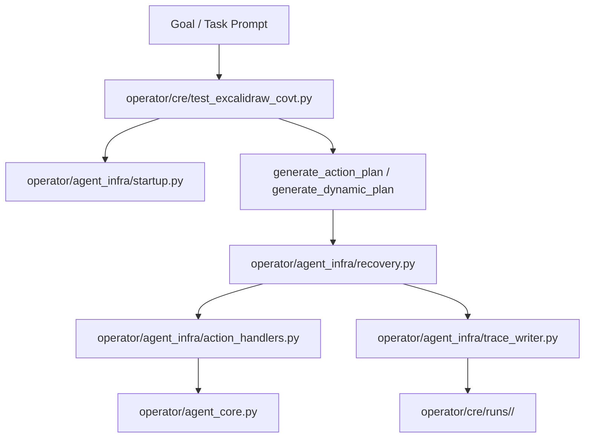
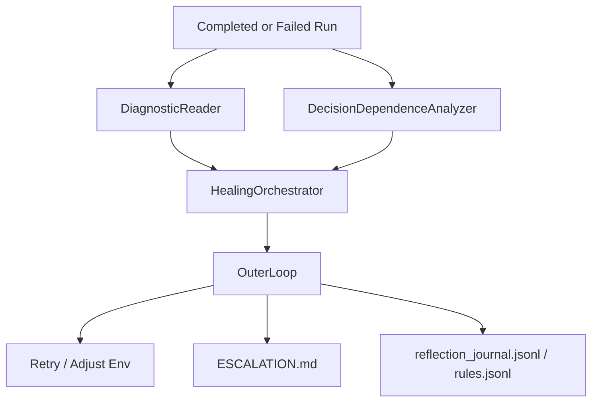
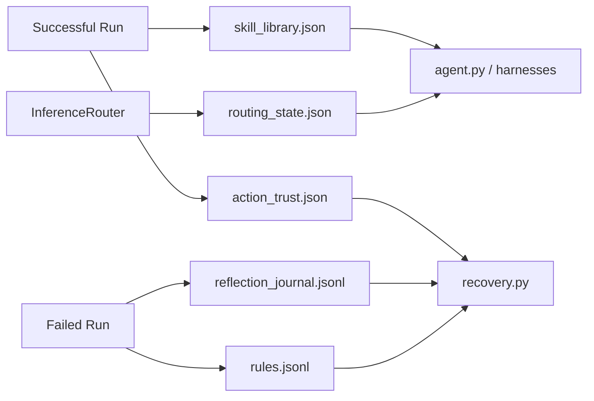
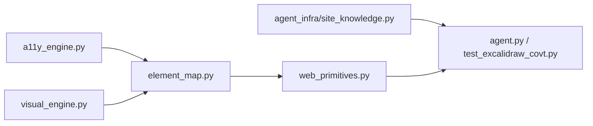

# Architecture Diagrams

## Method

These diagrams are derived from:
- `operator/cre/project_understanding/artifacts/import_graph.json`
- `operator/cre/project_understanding/artifacts/subsystem_dependency_report.json`
- `operator/cre/project_understanding/artifacts/artifact_flow_matrix.csv`
- `operator/cre/PROJECT_PHD_EXHAUSTIVE_DESCRIPTION.md`
- `operator/cre/DEEP_DIVE_ADDENDUM.md`

The modeling approach follows architecture-recovery and program-comprehension work:
- RepoUnderstander for repository-level synthesis
- ArchAgent for multi-view architecture documentation
- Ferrante et al. for dependence reasoning
- Cornelissen et al. for combining structure with dynamic evidence

## Diagram 1: Subsystem Dependency Overview

This diagram is generated from the subsystem dependency report. It shows how the
Python import graph clusters at subsystem level.

Interpretation:
- `experiment_harnesses` depends heavily on both `runtime_orchestrator` and `shared_infrastructure`.
- `shared_infrastructure` is internally dense but has limited outward dependency.
- `security` is intentionally small and lightly coupled.
- `cre_docs_and_artifacts` barely touches runtime code, which is correct for a doc-heavy surface.

## Diagram 2: Canonical Execution Stack

Interpretation:
- High-level intent becomes a plan in the harness layer.
- Recovery is the control hinge between planning and concrete action handlers.
- `agent_core.py` is the OS-level actuator.
- `trace_writer.py` turns every step into durable evidence.

## Diagram 3: Diagnose-Heal-Escalate Loop

Interpretation:
- Post-run reasoning is a first-class subsystem, not an afterthought.
- The outer loop is where evidence becomes memory and policy.

## Diagram 4: Persistent Learning and Control State

Interpretation:
- The project has several persistent memories, not one.
- These files influence future execution decisions and must be treated as active state.

## Diagram 5: Knowledge and Perception Stack

Interpretation:
- Perception is hybrid, not purely visual.
- Site knowledge sits beside perception rather than inside it.
